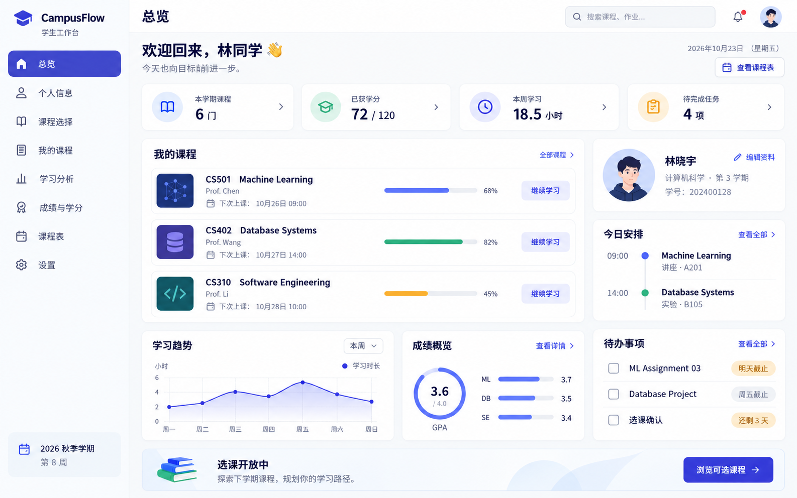
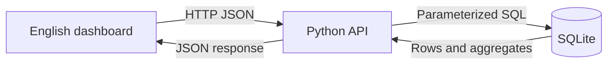

# CampusFlow · Student Dashboard

**From relational data to a student workspace.** CampusFlow connects a responsive,
English-language dashboard to a real SQLite database through a Python API.
After signing in, students can explore courses, manage enrollments, track tasks and review academic
progress in one place.

**Python · SQLite · SQL · JavaScript · HTML · CSS · GitHub Actions**

[Project walkthrough](docs/CASE_STUDY.md) · [Database design](docs/DATABASE.md) ·
[Validation results](docs/VALIDATION.md) · [Local setup](docs/LOCAL_SETUP.md) ·
[GitHub publishing guide / 中文](docs/GITHUB_GUIDE_ZH.md)

## Explore the result

- **Interactive demo:** deploy the included read-only preview with the
  [Pages workflow](.github/workflows/pages.yml). The workflow returns your real
  URL; no hosted URL has been created for this package yet.
- **Actual SQL output:** inspect [the exported dashboard response](docs/results.json).
- **Working application:** run `python app.py` and open http://127.0.0.1:8000.
- **Initial design direction:** shown below for comparison. This is an AI-generated
  Chinese design concept, **not a screenshot of the implemented English app**.
  The implemented application and Pages demo are the result to explore.

<details>
<summary>View the initial design concept</summary>



</details>

## Problem and scope

A student's course choices, weekly schedule, tasks and academic results often
live in separate views. This project brings those records into one SQL-backed
workspace, with aggregates that stay consistent after a student changes data.

The seeded version includes **one fictional student account**. API reads and writes use the signed-in student identity. It is a portfolio
and learning project, not a deployed university information system.

| View | Working behavior | Data source |
|---|---|---|
| Overview | Courses, earned credits, study hours, pending tasks | SQL joins and aggregates |
| My Profile | View identity; save name and email | `students` |
| Course Selection | Search, enroll, drop; detect full/conflicting courses | `courses`, `enrollments` |
| My Courses | Read course progress and descriptions | `courses`, `enrollments` |
| Learning Analytics | Weekly trend and credit-weighted GPA | `study_sessions`, `enrollments` |
| Grades & Credits | Completed and in-progress academic records | `courses`, `enrollments` |
| Timetable | Weekly schedule derived from active enrollments | `courses`, `enrollments` |
| Tasks | Mark tasks complete; persist status | `tasks` |

## Student registration

Choose **Create an account** on `/login`, or open `/register`. New accounts receive a server-generated student number and an independent empty workspace. Username uniqueness and password confirmation are checked server-side; passwords use salted hashes. After registration, sign in with the new username. [Upgrade guide / 中文](docs/REGISTER_SETUP_ZH.md).

## Run locally

Requires Python **3.10+**. No third-party packages or API keys are required.

```bash
# Run inside the repository root
python app.py
```

Open http://127.0.0.1:8000 and sign in with username `alex.morgan` and password `CampusFlow2026!`. Sessions expire after 8 hours; use **Sign out** to end a session. [Login upgrade instructions / 中文](docs/LOGIN_SETUP_ZH.md). On Windows you can use `py`; on macOS/Linux,
`python3`. The database initializes automatically on first launch. Refreshing or
restarting does not erase changes. [Detailed setup](docs/LOCAL_SETUP.md).

## How it works



The browser fetches `/api/dashboard`. Python joins student, enrollment and course
records, aggregates study sessions, and returns the data used by all seven
views. Updates are validated and written using parameterized SQL. Enrollment
checks and insertion share a write transaction.

**Pages demo:** the export script initializes a fresh temporary SQL database,
queries the same backend, and publishes the resulting JSON alongside the UI.
Navigation and search work; writes are disabled. GitHub Pages hosts static files
and does **not** run the Python server or connect to live SQLite.

## Reproduce an end-to-end change

1. Start the local app and sign in; the demo student has **3 active courses**.
2. Open **Course Selection** and enroll in **Data Visualization**.
3. Return to Overview: active courses increase to **4** and the weekly timetable
   includes the new course.
4. Restart the server: the enrollment remains in SQLite.
5. Drop the course: the count returns to **3**.
6. Try enrolling in **Artificial Intelligence** while enrolled in Machine
   Learning: the API rejects the overlapping Monday class.

[See SQL queries](queries.sql) · [API and data model](docs/DATABASE.md).

## Development process

| Stage | Deliverable | Evidence |
|---|---|---|
| Define | Student workflows and bounded scope | [Case study](docs/CASE_STUDY.md) |
| Design | Initial visual concept and English implementation | Concept image; `static/` |
| Model | Five relational tables and integrity rules | [schema.sql](schema.sql) |
| Implement | Query API, validated writes, seven UI views | `app.py`, `static/app.js` |
| Verify | API/database tests and JS syntax checks | [Validation](docs/VALIDATION.md), CI workflow |
| Present | Reproducible snapshot and read-only web demo | `scripts/build_demo.py`, `docs/demo/` |

These are explanatory project stages, not an invented historical commit log.
Actual Git history starts when you commit and push the project.

## Validation

```bash
python -m unittest -v test_app
node --check static/app.js
python scripts/build_demo.py
```

Integration tests use a separate temporary database. GitHub Actions is configured
to run the checks when pushed. Local verification is documented; hosted workflow
runs and browser visual QA have not yet been completed.

## Repository map

```text
app.py                    API, SQL operations and demo initialization
schema.sql                Tables, constraints and indexes
queries.sql               Example SQL analysis queries
static/                   English application UI
scripts/build_demo.py     Reproducible SQL → JSON → Pages demo export
test_app.py               Isolated integration tests
docs/                     Case study, ER diagram, results and setup
docs/demo/                Read-only GitHub Pages application
.github/workflows/        Tests and opt-in Pages deployment
```

SQLite files and caches are ignored by Git. A fresh checkout seeds its own
fictional database. `docs/results.json` and `docs/demo/snapshot.json` are
intentionally committed, generated demonstration outputs with no private data.

## Limitations and next steps

- Login uses salted PBKDF2 password hashes and expiring, server-side sessions.
  The included account is a public local demo credential. Registration is available; email verification and password reset are not implemented.
  For deployment, add HTTPS/Secure cookies, login throttling and an account lifecycle policy.
- Study logs, progress and grades are seed data; there is no automatic activity
  collection, teacher grading interface or learning content player.
- Uses a demonstration **4.0 GPA scale**, not the German grading system.
- The local standard-library HTTP server is for demonstration. Production
  deployment needs a production server, migrations and operational controls.
- Potential extensions: MySQL/PostgreSQL adapter, authenticated teacher view,
  grade import, attendance and richer progress analysis.

See [CHANGELOG.md](CHANGELOG.md) for the packaged version and
[CONTRIBUTING.md](CONTRIBUTING.md) for a change workflow. Code and documentation
were developed with AI assistance; the initial concept image was AI-generated.
No claim of real student usage, university deployment or measured impact is made.
