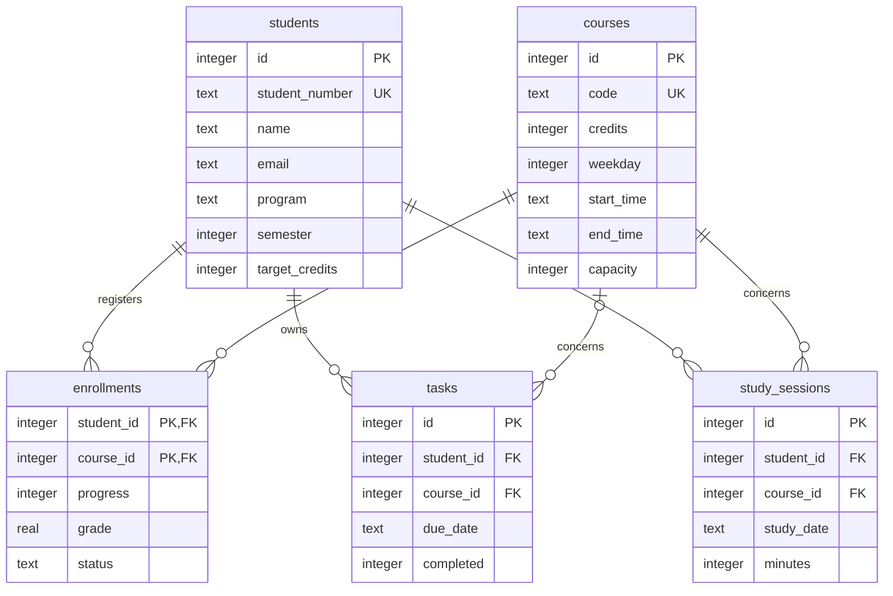

# Data model and API

## Entity relationships



`enrollments` resolves the student/course many-to-many relationship. Its composite
primary key prevents duplicate registrations. `tasks.course_id` is nullable for
academic-planning tasks. Foreign keys are enabled for each connection.
CHECK constraints bound progress, GPA, completion state and valid weekdays.
The date index supports a student's weekly study query.

## Metric definitions

| Metric | Calculation | Seeded example |
|---|---|---|
| Active courses | Count enrollments with status `active` | 3 |
| Earned credits | Sum credits for `completed` enrollments | 72 |
| GPA | Sum(grade × credits) / sum(credits with grades) | 3.60 / 4.00 |
| Weekly study | Sum session minutes Monday–Sunday, divided by 60 | Depends on snapshot day |
| Pending tasks | Count tasks with `completed=0` | 4 |

Only existing session records contribute to the weekly trend; no future values
are fabricated. Dates are ISO strings, times are zero-padded 24-hour strings.
All course meeting times refer to the same local teaching timezone in this demo.

## Enrollment transaction

1. Start `BEGIN IMMEDIATE` to serialize competing SQLite writers.
2. Validate the course and reject an existing registration.
3. Count active enrollments against capacity.
4. Reject a same-day overlap where existing start < new end and existing end > new start.
5. Insert and commit; validation failure rolls back automatically.

Back-to-back classes are allowed. Dropping a course removes its active enrollment
only; existing learning logs and tasks are retained.

## Endpoints

| Method | Path | Purpose |
|---|---|---|
| GET | `/api/dashboard` | Current student, enrolled courses, catalog, tasks, weekly trend, totals and date |
| POST | `/api/profile` | Update demo student's name and email |
| POST | `/api/tasks` | Update owned task completion |
| POST | `/api/enrollments` | Enroll or drop |

Example bodies:

```json
{"name":"Alex Morgan","email":"alex@example.org"}
```

```json
{"id":1,"completed":true}
```

```json
{"course_id":4,"enroll":true}
```

POST success returns `{"ok":true}`. Invalid inputs/business-rule failures return
400, rejected cross-origin writes 403, missing routes 404 and SQL failures 500.
SQL parameters are bound; frontend record text is escaped before HTML rendering.
The server remains loopback-only for local demonstration. API reads/writes now require an authenticated session.

## Login and sessions

`accounts` has a student foreign key, unique username, random salt and PBKDF2-HMAC-SHA256 password hash (260,000 iterations).
`sessions` stores SHA-256 hashes of random tokens and an absolute expiry timestamp.
Login sets an HttpOnly, SameSite=Strict cookie; sessions expire after eight hours.
Logout deletes the server-side session and clears its cookie. Secure cookies require
HTTPS in a future production deployment; this server intentionally uses local HTTP.

| Method | Path | Purpose |
|---|---|---|
| GET | /login | English login screen |
| POST | /api/login | Username/password verification; session rotation |
| POST | /api/logout | Invalidate current session |

Dashboard queries and writes derive student ID from the session, never a request
body. Anonymous data access returns 401. POST expects JSON; foreign Origin headers
are rejected. Editing a contact email does not change the login username.

## Registration

`GET /register` serves the English registration form.
`POST /api/register` accepts name, email, username, program, password and
confirm_password. Success returns 201 without automatically creating a session.
Usernames are normalized to lowercase and checked for uniqueness (409 on conflict).
Validation failures return 400. Student and account creation are one transaction.
Student number is generated by the server; semester starts at 1 and target credits
at 120. New users receive no copied enrollments, grades, tasks or study records.
Emails are contact fields; email ownership is not verified and email uniqueness is
not enforced. Login identity is the unique username.
